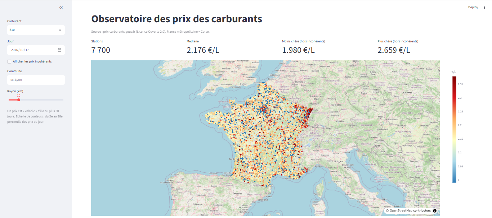
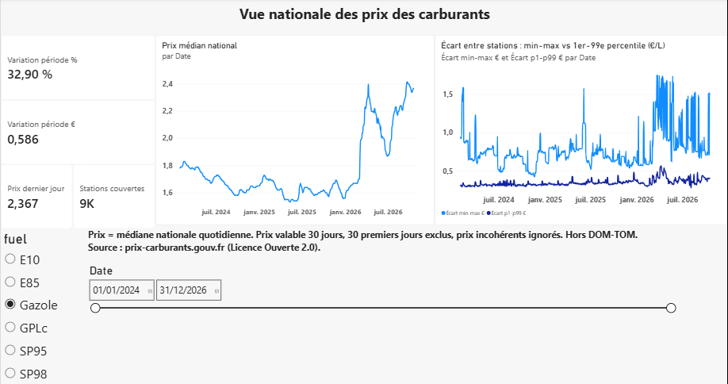
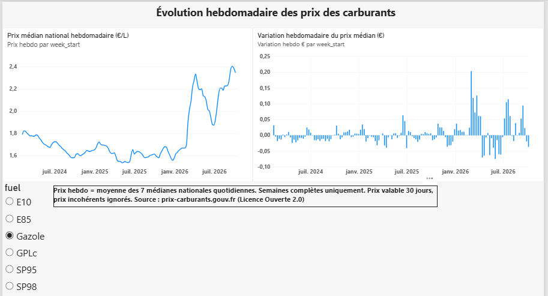
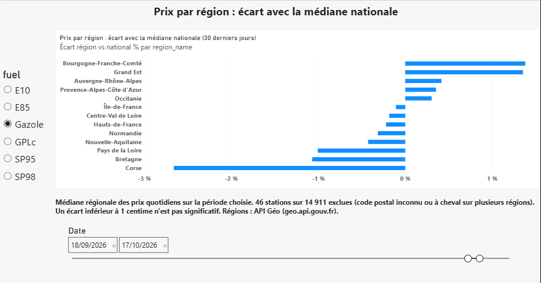

# Observatoire des prix des carburants en France

Pipeline automatisé qui récupère chaque jour les prix des carburants des stations-service françaises, garde l'historique, calcule des statistiques fiables (nationales, hebdomadaires, régionales) et les affiche dans une **carte interactive** et un **rapport Power BI**.



## Questions auxquelles le projet répond
- Quel est le prix médian du Gazole, du SP95, du SP98, de l'E10, de l'E85 et du GPLc, jour par jour ?
- Où sont les stations les moins chères autour d'une commune ?
- Quel est l'écart entre une région et la médiane nationale ?
- Comment les prix évoluent-ils d'une semaine à l'autre ?

## Source des données
| | |
|---|---|
| Jeu de données | Prix des carburants en France (flux instantané, fichier annuel) |
| Fournisseur | Ministère de l'Économie, `donnees.roulez-eco.fr/opendata` |
| Format | ZIP contenant un XML, mis à jour chaque jour |
| Licence | Licence Ouverte 2.0 (réutilisation libre avec mention de la source) |
| Couverture | France métropolitaine + Corse. DOM-TOM exclus de l'analyse |
| Régions | API Géo (`geo.api.gouv.fr`), code postal → région |
| Fond de carte | © OpenStreetMap contributors |

Les prix sont **déclarés par les stations**. Ils ne sont pas vérifiés par l'État.

## Architecture
```
Fichier officiel (ZIP/XML)
  → data/raw/ (archive datée, jamais supprimée)
  → nettoyage + contrôles qualité
  → PostgreSQL 17 (Docker) : base de référence, historique en ajout seul
  → DuckDB : calculs analytiques (jetable, reconstruit à volonté)
  → CSV : daily_stats, weekly_stats, region_daily_stats
  → Power BI (3 pages)    et    Streamlit + Plotly (carte)
```

| Outil | Pourquoi | Alternative écartée |
|---|---|---|
| PostgreSQL | Base de référence, clés uniques, transactions | Fichiers CSV : pas d'unicité garantie |
| DuckDB | Calculs rapides sur l'historique (médianes, jointure temporelle) | Pandas : plus lourd pour ce volume |
| Streamlit + Plotly | Carte fluide avec environ 14 900 points | Power BI : lent et peu souple pour tant de points |
| Power BI | Tableaux de bord de synthèse | — |
| Planificateur Windows | Suffisant pour une exécution par jour | Airflow : trop lourd pour un seul pipeline |

## Règles de calcul
- **Prix « valable »** : un prix reste valable 30 jours après sa dernière mise à jour. Au-delà, la station sort du calcul.
- **Période de chauffe** : les 30 premiers jours de l'historique sont exclus (première date analysée : 31/01/2024).
- **Prix incohérents** : un prix est **marqué** (jamais supprimé) s'il est inférieur à 0,7 fois ou supérieur à 1,5 fois la médiane du jour (seuil haut appliqué au Gazole, SP95, SP98 et E10 ; l'E85 et le GPLc ont naturellement de grands écarts).
- **Médiane nationale** : calculée par jour et par carburant, sur les prix valables et cohérents.
- **Semaine** : du lundi au dimanche. Prix hebdomadaire = moyenne des 7 médianes quotidiennes. Seules les semaines complètes comptent. La variation n'est calculée que si la semaine précédente existe.
- **Région** : déduite du code postal. Un code postal à cheval sur plusieurs régions, ou inconnu, exclut la station des statistiques régionales (comptée et affichée, jamais devinée).

## Résultats observés (à partir des données réellement traitées)
- **Volume** : 14 283 220 prix chargés, du 01/01/2024 au 17/10/2026.
- **Gazole, 17/10/2026** : médiane nationale 2,367 €/L, sur 9 432 stations.
- **Gazole, évolution** : +32,90 % entre le premier et le dernier jour analysés (rapport Power BI, période complète).
- **Régions, Gazole, 17/10/2026** : Grand Est environ +1,35 % au-dessus de la médiane nationale, Corse environ −3,70 % en dessous.
- Un écart régional dépend de la période : sur la période complète, le classement n'est pas le même que sur un seul jour.

| Page Power BI | |
|---|---|
| National |  |
| Hebdomadaire |  |
| Régions |  |

### Test de sensibilité : combien de jours un prix reste-t-il valable ?
Mesuré le 17/10/2026, Gazole (14 911 stations sur la carte) :

| Validité | Stations | % des stations | Médiane |
|---|---|---|---|
| 7 jours | 7 734 | 51,9 % | 2,359 |
| 14 jours | 8 787 | 58,9 % | 2,362 |
| **30 jours (choisi)** | 9 432 | 63,3 % | 2,367 |
| 60 jours | 9 633 | 64,6 % | 2,366 |
| 90 jours | 9 717 | 65,2 % | 2,365 |

Passer de 30 à 90 jours ajoute 285 stations et change la médiane de 0,002 €. Le choix de 30 jours est donc stable. Le résultat vaut pour un seul jour.

## Qualité et fiabilité
- **Archivage** : chaque fichier brut est conservé avec sa date et son empreinte SHA-256.
- **Pas de double insertion** : un fichier identique (même SHA-256) est ignoré. Clé unique sur (station, carburant, date de mise à jour).
- **Réseau** : nouvelles tentatives avec attente croissante pour les pannes et erreurs 5xx. Aucun fichier incomplet n'est archivé.
- **Verrou** : une seule exécution à la fois (verrou PostgreSQL).
- **Contrôles** : nombre minimal de stations, part de lignes rejetées, fraîcheur des données.
- **Suivi** : `python -m fuel.run_daily --status` affiche le dernier succès (code de sortie 1 s'il date de plus de 36 h).
- **Tests** : 75 tests automatiques (`pytest -q`).

## Installation
Prérequis : Python 3.12, Docker Desktop, Power BI Desktop (optionnel).
```powershell
git clone https://github.com/saaddiri/prix-carburants-france.git
cd prix-carburants-france
python -m venv .venv
.\.venv\Scripts\Activate.ps1
pip install -r requirements.txt
copy .env.example .env        # puis choisis un mot de passe dans .env
docker compose up -d
$env:PYTHONPATH = "src"
```

## Utilisation
```powershell
python -m fuel.run_daily                    # télécharge, charge, contrôle
python -m fuel.analytics                    # calculs DuckDB + exports
python -m fuel.geo --no-fetch               # relie stations et régions
python -m fuel.trends                       # statistiques hebdomadaires
python -m fuel.regional                     # médianes par région
python -m fuel.nearby --commune Lyon --fuel Gazole --radius 10
streamlit run app\streamlit_app.py          # carte interactive
python -m fuel.sensitivity                  # test de la durée de validité
```
Ferme Streamlit avant de relancer les calculs (DuckDB n'accepte qu'un accès en écriture). Relancer `analytics` recrée la base : refais ensuite `geo --no-fetch`, `trends` et `regional`.

Le rapport `powerbi/prix-carburants.pbix` lit les CSV avec un chemin local : modifie la source dans Power Query → *Paramètres de la source de données*.

## Limites
- **Historique** : les données commencent le 01/01/2024 et s'arrêtent au 17/10/2026. Les analyses ne portent que sur cette période.
- **Couverture** : sur la carte, le Gazole couvre 63 % des stations, l'E10 52 %, l'E85 26 %, le GPLc 8 %. Une grande part vient de stations qui ne vendent pas ce carburant. Le test de fraîcheur ne permet pas de distinguer une station qui ne vend pas un carburant d'une station qui ne publie pas.
- **Prix déclarés** : non vérifiés. Les valeurs incohérentes sont marquées, pas corrigées.
- **Régions** : une petite part des stations est exclue (code postal inconnu ou à cheval sur plusieurs régions).
- **Pas d'alerte automatique en cas d'échec** : seuls les logs et la commande `--status` permettent de le détecter.
- **Seuils** : 0,7 et 1,5 fois la médiane sont des choix documentés, pas une vérité.
- Mesures Power BI vides si plusieurs carburants sont sélectionnés (mélanger des carburants n'a pas de sens).

## Licence
Code : à choisir (ex. MIT). Données : Licence Ouverte 2.0, source prix-carburants.gouv.fr.